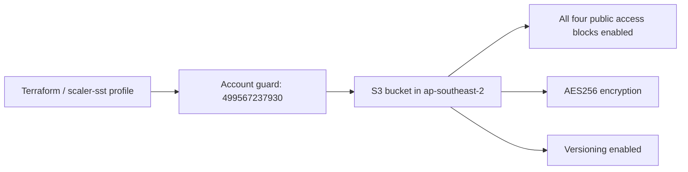
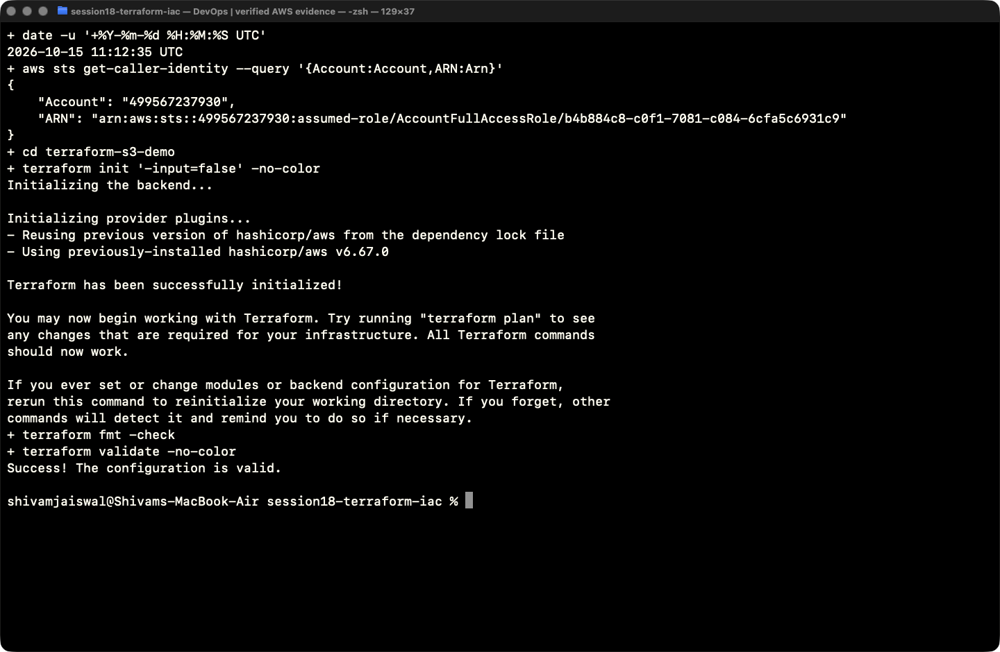
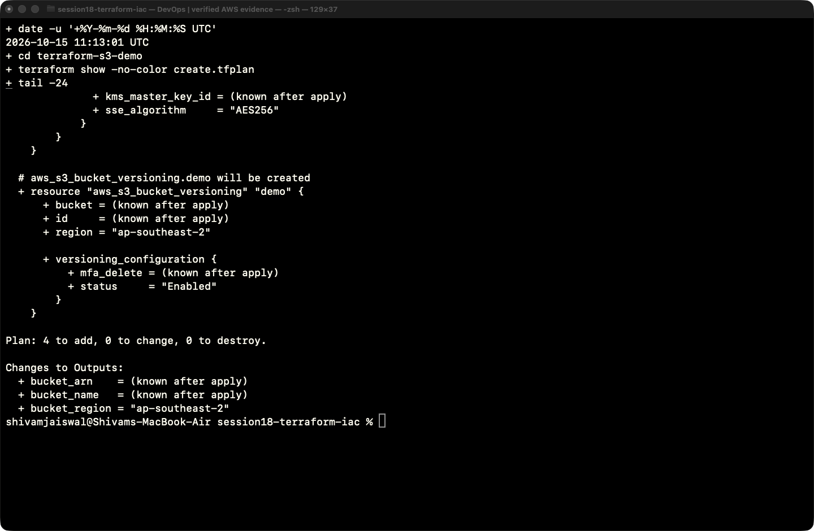
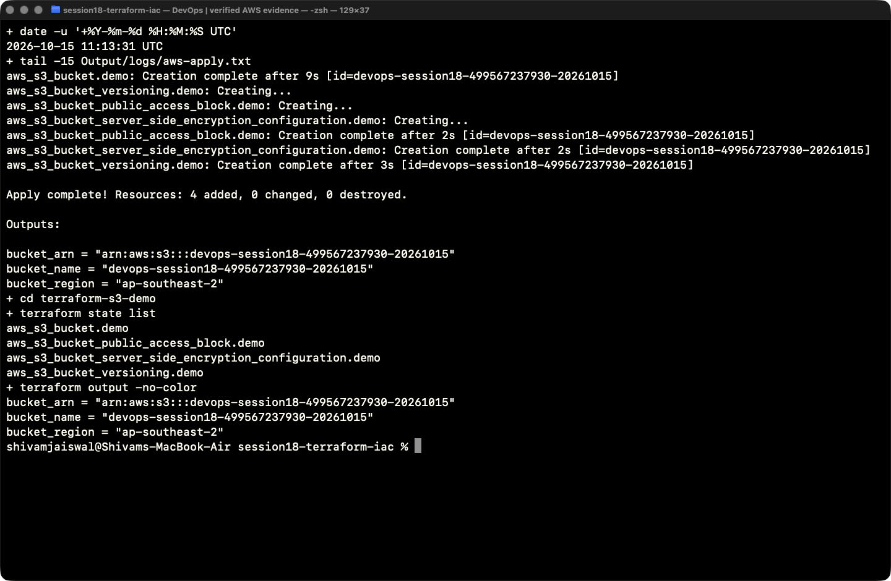
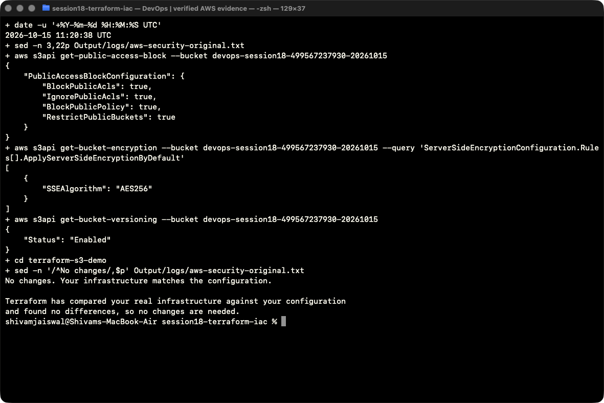
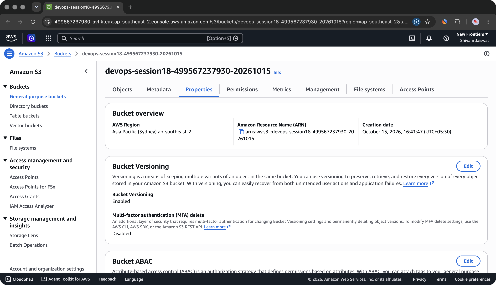
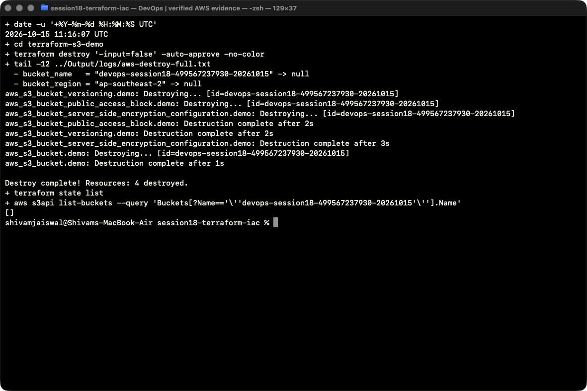

# Session 18 · Terraform and Infrastructure as Code

**Shivam Jaiswal · Completed live AWS lab · 15 October 2026**

Terraform created a private, encrypted, versioned S3 bucket in **Asia Pacific (Sydney), `ap-southeast-2`**, using the Scaler AWS account **`499567237930`**. AWS API checks and the Console confirmed its configuration. The empty bucket and all four Terraform resources were then destroyed; the final state and AWS bucket lookup are empty.

## Assignment coverage

| Requirement | Submission and result |
|---|---|
| Inspect and correct the supplied Terraform example | [Source and setup](terraform-s3-demo/README.md); invalid output `type` arguments removed |
| Provider, variables, resources and outputs | AWS 6.67.0 lock; profile/region/account/name variables; four resources; bucket name/ARN/region outputs |
| Initialize, format, validate, plan and apply | Successful; live plan contained **4 additions** |
| Inspect state and verify AWS | Four resource addresses; Block Public Access, AES256 and versioning confirmed |
| Destroy and verify cleanup | **4 destroyed**; empty Terraform state; bucket absent from account listing |
| Research five AWS service areas | IAM, EC2, S3, VPC, DynamoDB/RDS READMEs below |

## Architecture and account isolation



Recorded bucket: `devops-session18-499567237930-20261015`. It contained no objects. `force_destroy=false` prevents silently deleting unexpected content. The provider's `allowed_account_ids` prevents deployment through another account. Credentials remain in the AWS CLI login cache; no access keys are committed. Existing buckets, containers and profiles from other accounts were not used.

## Reproduce the lab

Use the existing `scaler-sst` profile backed by the authorized AWS login. If its temporary session expires, renew it with `aws login --profile scaler-sst-login --region ap-southeast-2`. Verify the account before proceeding:

```bash
export AWS_PROFILE=scaler-sst AWS_REGION=ap-southeast-2 AWS_PAGER=""
aws sts get-caller-identity --query Account --output text
cd session18-terraform-iac/terraform-s3-demo
# Change bucket_name in terraform.tfvars to a fresh globally unique lab name.
terraform init
terraform fmt -check
terraform validate
terraform plan -out=create.tfplan
terraform apply create.tfplan
terraform state list
terraform output
aws s3api get-public-access-block --bucket "$(terraform output -raw bucket_name)"
aws s3api get-bucket-encryption --bucket "$(terraform output -raw bucket_name)"
aws s3api get-bucket-versioning --bucket "$(terraform output -raw bucket_name)"
terraform plan -detailed-exitcode
terraform destroy -auto-approve
terraform state list
```

The drift check returned **no changes**. Detailed plan exit codes are 0 for no changes, 2 for proposed changes and 1 for errors. State and saved plans remain local and ignored. A previously applied saved plan must be regenerated before another apply.

## Screenshots and execution records

These are real Terminal and Chrome window captures, following the earlier session format: readable commands/results, browser address bar, no surrounding desktop. Full plan/apply/destroy output is retained beside the screenshots. The apply screenshot reads the recorded creation transcript and then queries the actual state and outputs.

### 07 · Authorized identity, initialization and validation



[Transcript](Output/logs/07-authorized-init.txt).

### 08 · Four-resource creation plan



[Transcript](Output/logs/08-s3-plan.txt) · [Full live plan](Output/logs/aws-plan.txt).

### 09 · Successful apply, resource state and outputs



[Transcript](Output/logs/09-apply-and-state.txt) · [Original apply output](Output/logs/aws-apply.txt).

### 10 · AWS security checks and unchanged infrastructure



[Transcript](Output/logs/10-s3-security.txt).

### 11 · AWS Console: Sydney bucket and enabled versioning



### 12 · Successful destruction and absence check



[Transcript](Output/logs/12-destroy-verified.txt) · [Full destroy output](Output/logs/aws-destroy-full.txt).

## AWS service research

| Topic | Completed research |
|---|---|
| IAM | [Identities, roles, policies and least privilege](aws-services/01-iam/README.md) |
| EC2 | [Instances, lifecycle, AMIs, storage and network security](aws-services/02-ec2/README.md) |
| S3 | [Objects, buckets, encryption, versioning and policies](aws-services/03-s3/README.md) |
| VPC | [Subnets, routes, gateways and security groups](aws-services/04-vpc/README.md) |
| DynamoDB and RDS | [Database models, use cases and managed-service tradeoffs](aws-services/05-dynamodb-rds/README.md) |

## Earlier blocker and lesson learned

The 7 October attempt used a different identity and was denied `s3:CreateBucket`. Its original screenshots `01`–`06` and [failed-apply transcript](Output/logs/05-apply.txt) remain as historical troubleshooting evidence. They do not describe this completed run. The blocker was resolved by using the authorized Scaler account; no permission changes were made to the old identity. [IAM notes](iam/README.md) explain the distinction between authenticating and being authorized to provision resources.

Text transcripts use LF line endings with terminal color/control codes removed for readability. Commands and result values are preserved; screenshots remain the original native window captures.

[Visual screenshot verification and file hashes](Output/SCREENSHOT-VERIFICATION.md).
