# Session 19 · Cloud and Terraform in Action

**Shivam Jaiswal · Live AWS mini-project · 15 October 2026**

The supplied networking example was extended into a complete **VPC + EC2 web server + private S3** project. It was provisioned and verified in **AWS account `499567237930`, Sydney (`ap-southeast-2`)**. The browser served the Session 19 page, AWS reported healthy EC2 system/instance checks, and all eleven Terraform resources were destroyed after recording the evidence.

## Requirement map

| Requirement | Delivered result |
|---|---|
| Provider and input variables | AWS 6.67.0 lock; region/profile/account, bounded instance type, unique bucket name and current IPv4 `/32` |
| Resource dependencies | Six network resources, one EC2 instance and four S3 resources; references and route dependency define ordering |
| Plan and apply | Initial live plan: **11 additions**; completed apply after repairing one AWS-invalid description |
| Outputs and state | VPC, subnet, security group, EC2 ID/public IP/URL, S3 name and region; eleven managed resources plus the AMI data source |
| Working cloud service | Amazon Linux 2023 + Nginx; HTTP page verified by script and Chrome |
| Security checks | Single-source HTTP, no SSH, IMDSv2, encrypted disposable gp3 root disk, private/encrypted/versioned S3 |
| Drift and cleanup | No-change plan; **11 resources destroyed**, empty state and AWS absence checks |

## Deployed architecture

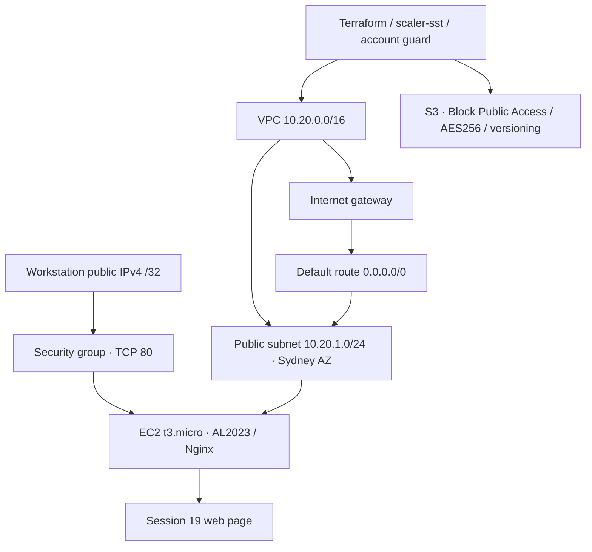

S3 is independently provisioned; the web server does not read its page from the bucket. This is a short, single-instance classroom lab. It has no NAT gateway, SSH key pair, load balancer or IAM role creation.

## Recorded resources

| Item | Value from the live run |
|---|---|
| Profile / account | `scaler-sst` / `499567237930` |
| Region | `ap-southeast-2` |
| VPC | `vpc-028b9710ea8609a72` |
| Public subnet | `subnet-0c184d8abf3926c39` |
| Security group | `sg-0e069ef5910995b1d` |
| EC2 instance | `i-0522f5d4ea618a6f5` · `t3.micro` |
| HTTP endpoint during the demonstration | `http://54.153.170.46` |
| Empty S3 bucket | `devops-session19-499567237930-20261015` |
| Final state | Lab resources removed; endpoint is no longer available |

Only fresh resources belonging to this lab were removed. Existing networking, buckets, other-account resources and local containers were not used. The provider enforces `allowed_account_ids` to prevent selecting another AWS account by mistake.

## Reproduce

From the repository root, use the existing authorized profile and a new globally unique bucket name. Renew the login with `aws login --profile scaler-sst-login --region ap-southeast-2` if necessary.

```bash
export AWS_PROFILE=scaler-sst AWS_REGION=ap-southeast-2 AWS_PAGER=""
aws sts get-caller-identity --query Account --output text
cd session19-cloud-terraform/08-mini-project
cp terraform.tfvars.example terraform.tfvars
# Replace the example IPv4/32 with your current public IPv4/32.
# Set a fresh unique bucket_name; preserve the expected account ID.
terraform init
terraform fmt -check
terraform validate
terraform test
terraform plan -out=create.tfplan
terraform apply create.tfplan
terraform state list
terraform output
bash verify.sh
terraform plan -detailed-exitcode
terraform plan -destroy -out=destroy.tfplan
terraform apply destroy.tfplan
terraform state list
```

`terraform test` runs two mock-provider security tests; those check configuration without contacting AWS. The real plan/apply, `verify.sh`, HTTP response, Console screenshots and teardown below separately establish cloud execution. `verify.sh` waits for healthy EC2 status checks, checks VPC/instance/S3 configuration and asserts the page contains the student/session marker.

The first apply exposed an AWS restriction: security-group descriptions do not permit an apostrophe. Terraform mocks did not catch this API validation rule. The description was corrected; a fresh plan added the two remaining resources without duplicating the nine resources already in state. The initial failure and successful recovery are both retained in the transcripts. Browser inspection also caught a missing UTF-8 declaration; the page was corrected and Terraform replaced the disposable instance. The resource table and final screenshots show that replacement instance.

## Screenshot evidence

Real native Terminal and Chrome window screenshots follow the earlier session style. Full logs retain commands and results. The apply screenshot shows the recorded successful retry and then queries all eleven managed resources plus the AMI data source.

### 01 · Authorized identity, init, validate and two passing mock tests

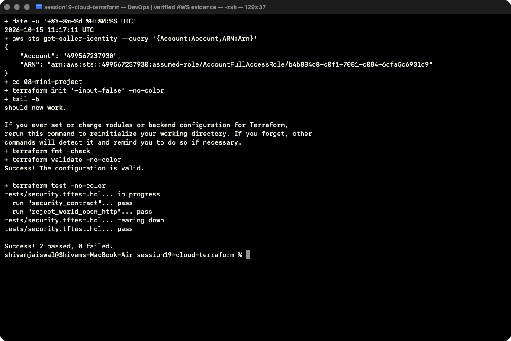

[Terminal transcript](Output/logs/01-identity-and-validation.txt).

### 02 · Initial eleven-resource live plan

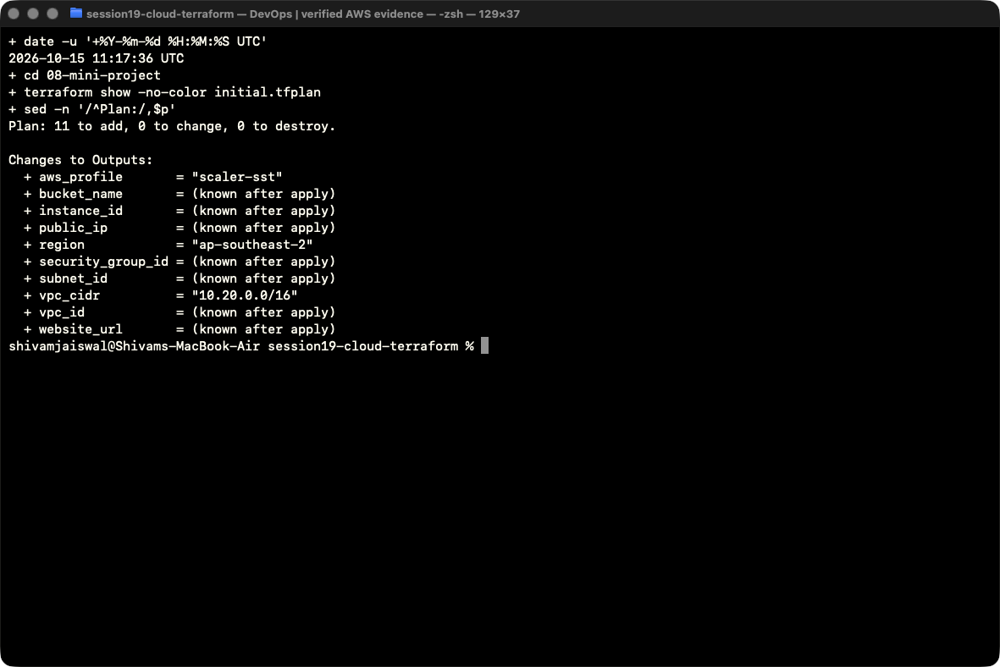

[Terminal transcript](Output/logs/02-live-plan.txt).

### 03 · Successful apply, outputs and managed resource addresses

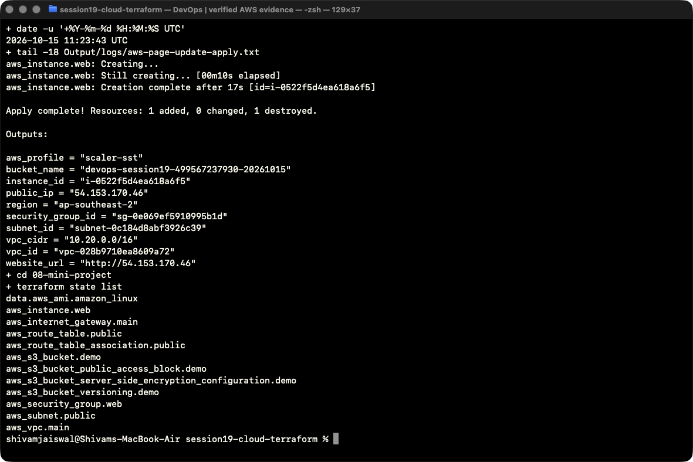

[Terminal transcript](Output/logs/03-apply-state-outputs.txt).

### 04 · Available VPC, running instance, IMDSv2 and healthy status checks

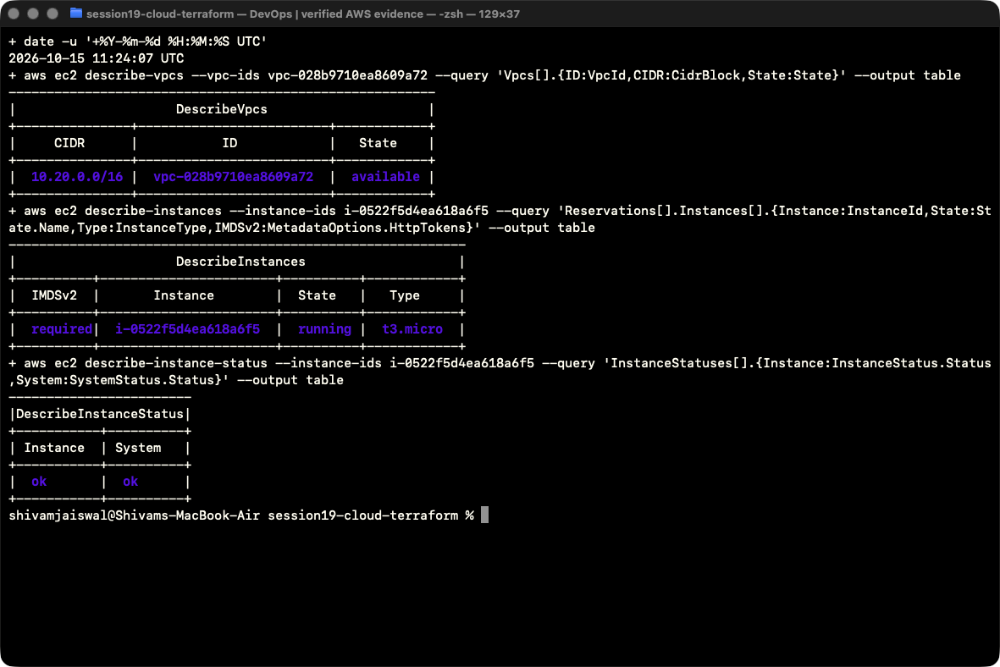

[Terminal transcript](Output/logs/04-vpc-ec2-verification.txt).

### 05 · Private encrypted/versioned S3 and verified HTTP response

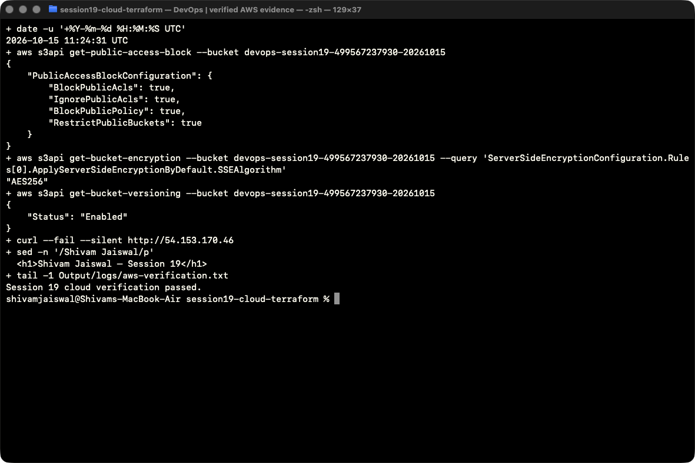

[Terminal transcript](Output/logs/05-s3-and-http.txt).

### 06 · Real Nginx page in Chrome

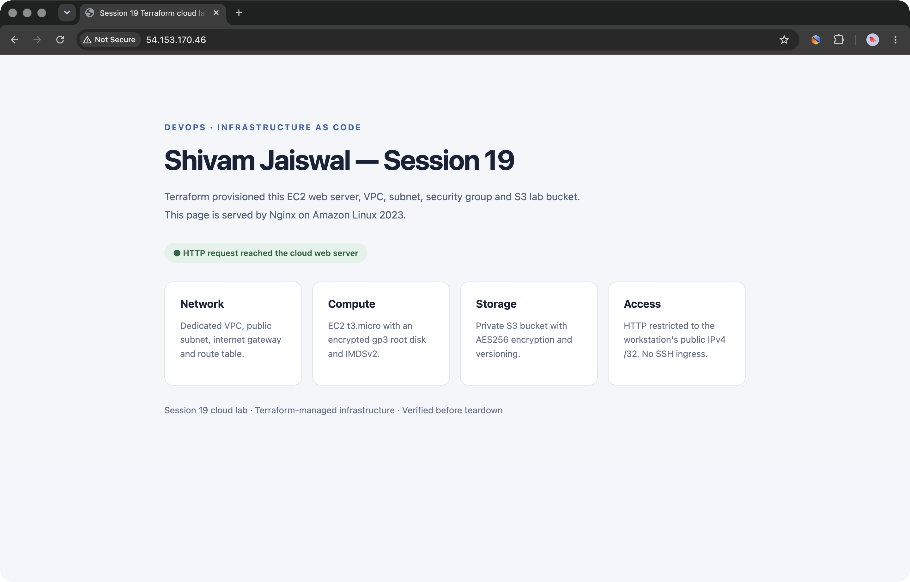

### 07 · AWS audit history: the original VPC was created and deleted

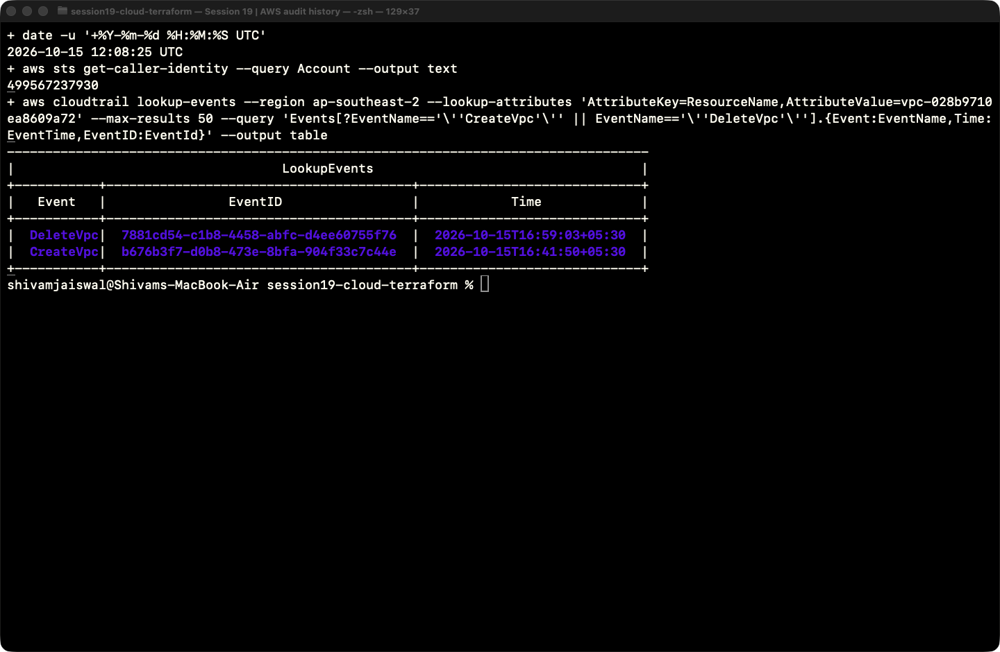

[Actual command output](Output/logs/07-vpc-audit-history.txt) · [AWS event records](Output/logs/aws-vpc-cloudtrail-history.json).

The original VPC Console capture was rejected during visual review because it showed a loading screen. This replacement is a native Terminal screenshot of a fresh, read-only AWS CloudTrail lookup for `vpc-028b9710ea8609a72`. It shows the original CreateVpc and DeleteVpc events after the lab was torn down. The completed EC2 Console view below also shows the same VPC ID; no resources were recreated for this verification.

### 08 · AWS Console: the EC2 instance

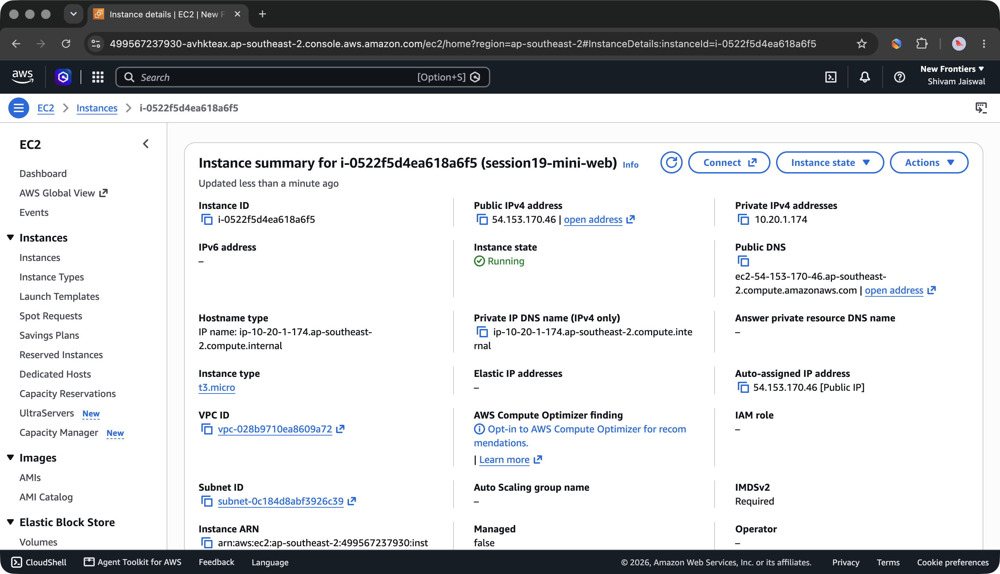

### 09 · Terraform confirms no infrastructure drift

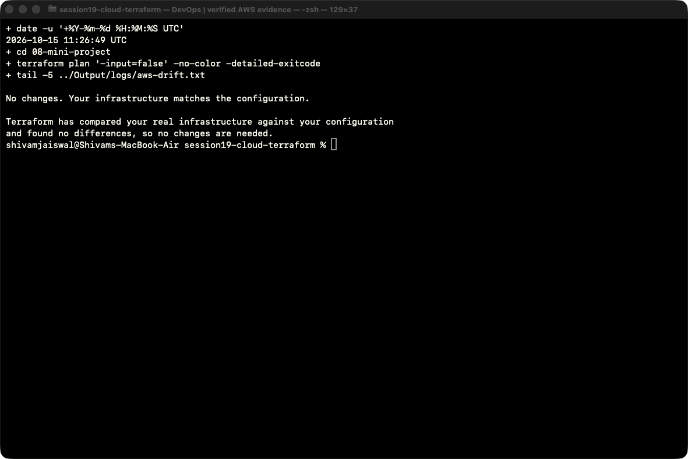

[Terminal transcript](Output/logs/09-no-drift.txt).

### 10 · Eleven resources destroyed and AWS absence checks

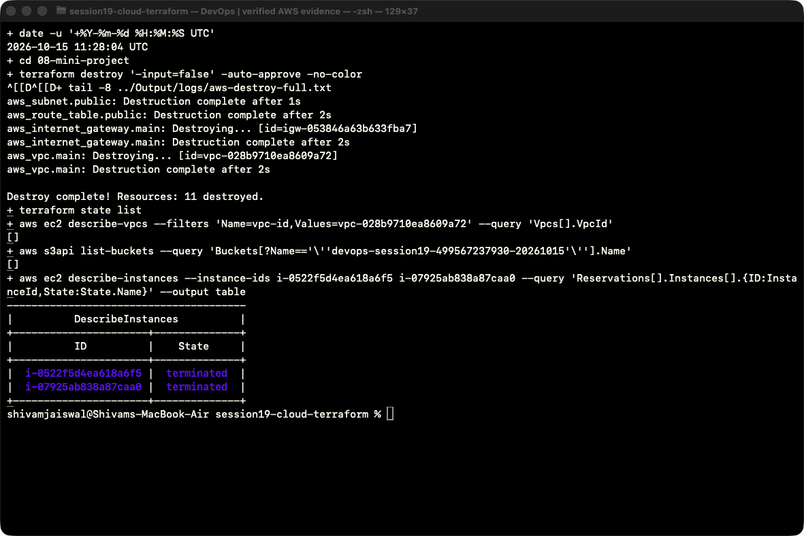

[Terminal transcript](Output/logs/10-destroy-verified.txt).

### Full execution records

[Initial live plan](Output/logs/aws-plan.txt) · [First apply and rejected description](Output/logs/aws-apply.txt) · [Recovery plan](Output/logs/aws-retry-plan.txt) · [Successful initial apply](Output/logs/aws-apply-retry.txt) · [UTF-8 page replacement apply](Output/logs/aws-page-update-apply.txt) · [Complete AWS/HTTP verification](Output/logs/aws-verification.txt) · [Full destroy](Output/logs/aws-destroy-full.txt).

## Cleanup and lessons

The root EBS volume is encrypted and `delete_on_termination=true`. The S3 bucket was empty and `force_destroy=false`; unexpected objects would stop cleanup instead of being silently deleted. After the actual destroy, state contains no resource addresses, the VPC and bucket no longer appear in AWS, and the recorded instance is terminated.

A valid HCL configuration and passing mock tests cannot guarantee that AWS will accept every parameter. Keep state after a partial apply, fix the cause, regenerate the plan and let Terraform reconcile the missing resources. A successful STS call proves identity, while API calls and a served HTTP page prove the deployed behavior.

## References and source

[Mini-project source and setup](08-mini-project/README.md) · [Terraform test mocking](https://developer.hashicorp.com/terraform/language/tests/mocking) · [AL2023 on EC2](https://docs.aws.amazon.com/linux/al2023/ug/ec2.html) · [EC2 resource](https://registry.terraform.io/providers/hashicorp/aws/latest/docs/resources/instance) · [VPC concepts](https://docs.aws.amazon.com/vpc/latest/userguide/what-is-amazon-vpc.html).

Text transcripts use LF line endings with terminal color/control codes removed for readability. Commands and result values are preserved; screenshots remain the original native window captures.

[Visual screenshot verification and file hashes](Output/SCREENSHOT-VERIFICATION.md).
