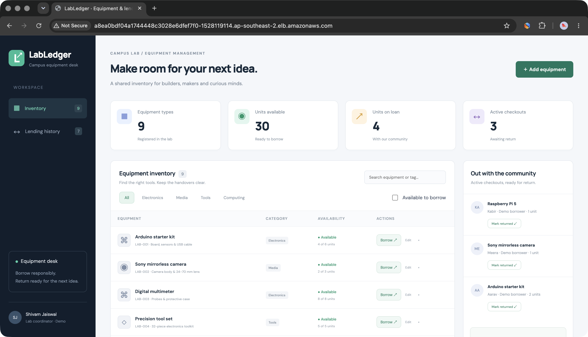
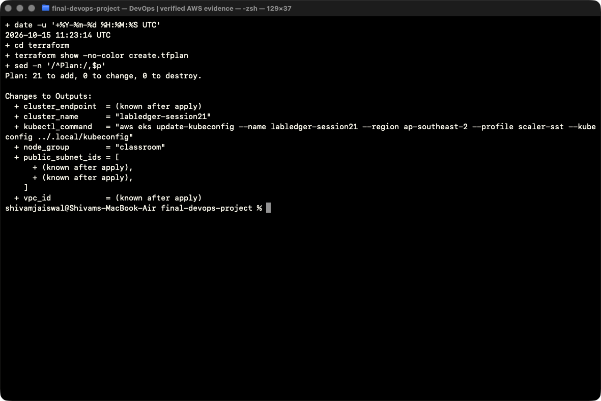
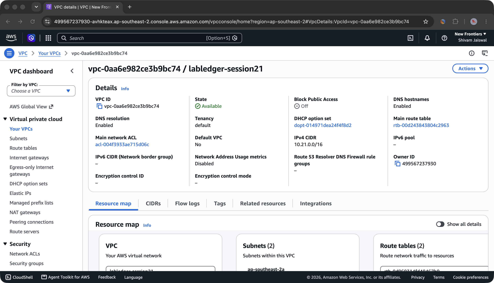
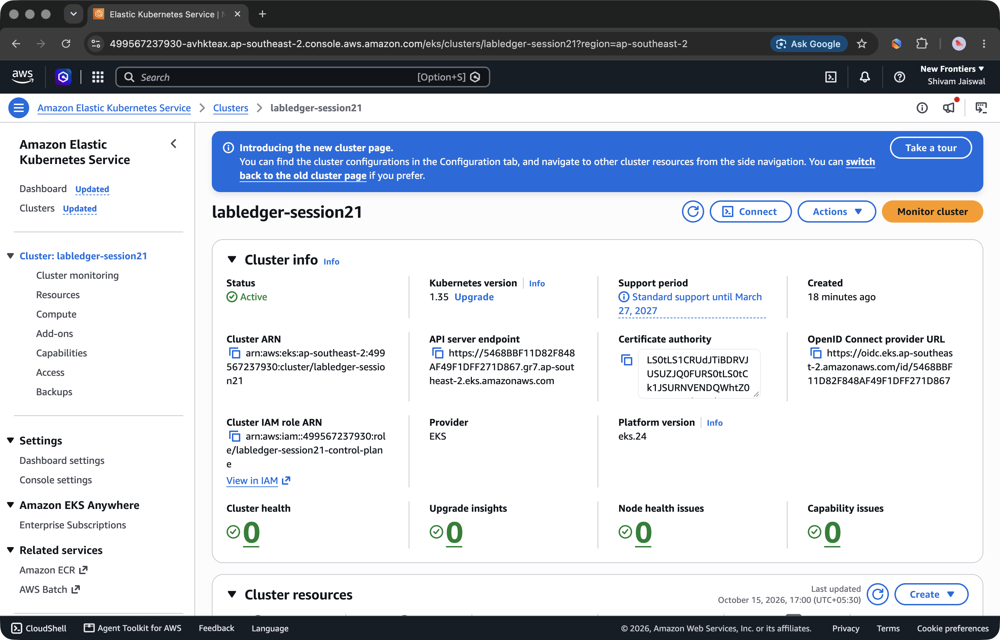
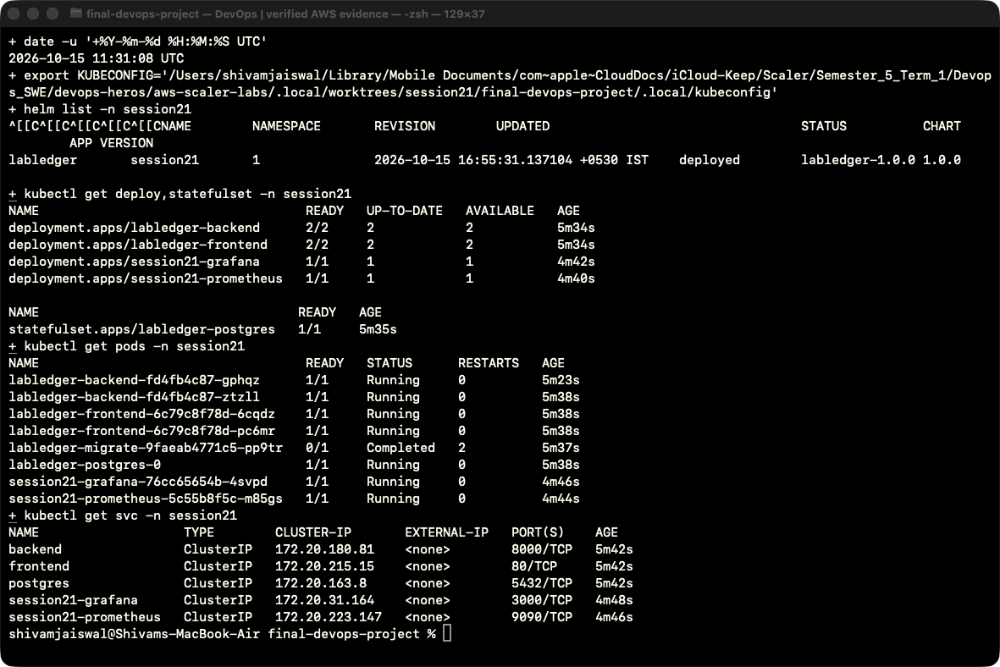
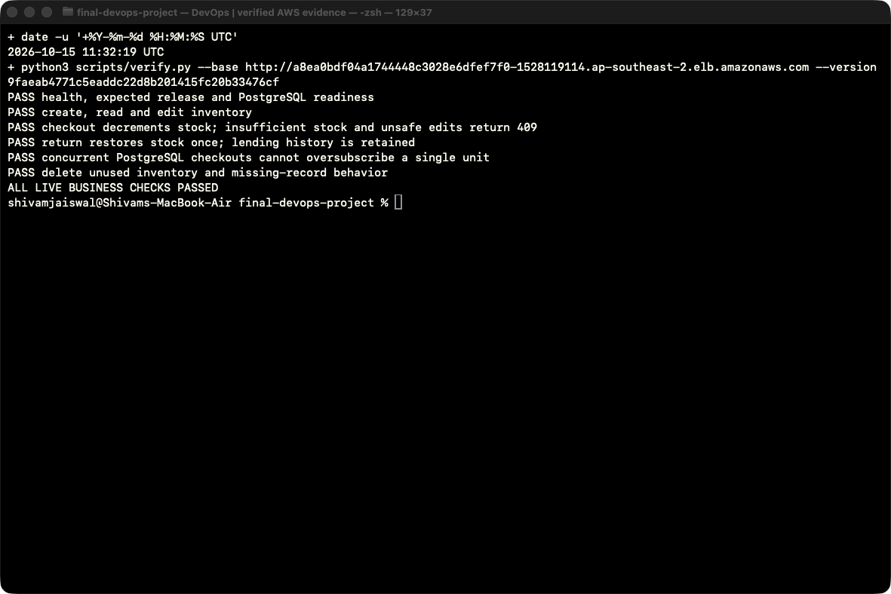
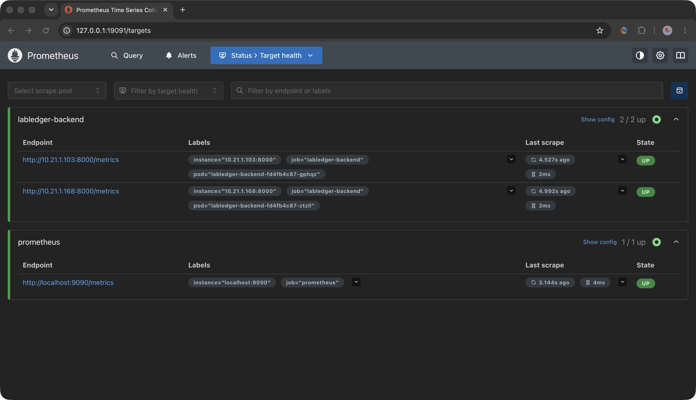
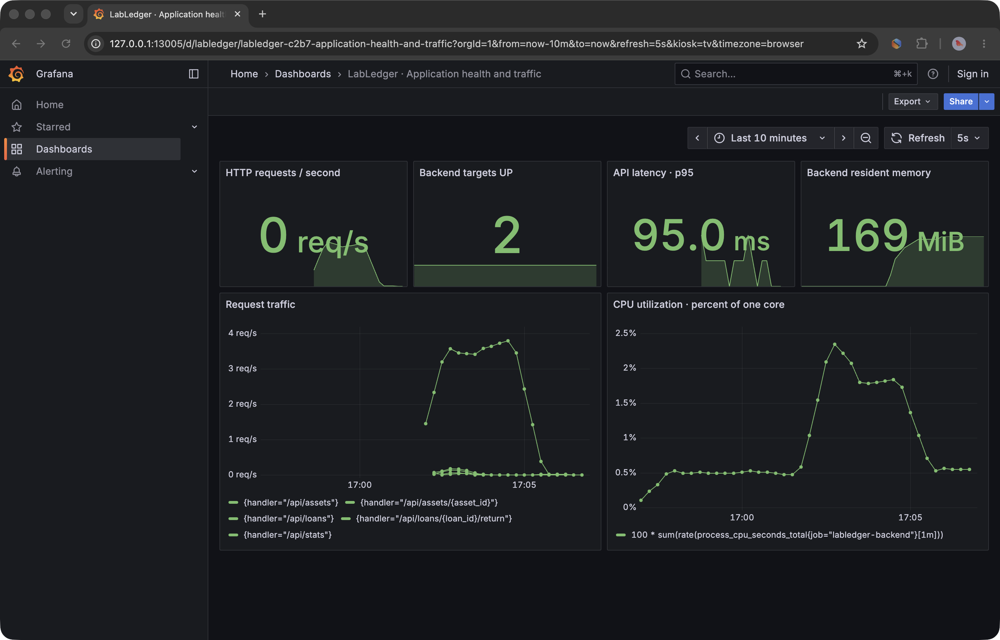
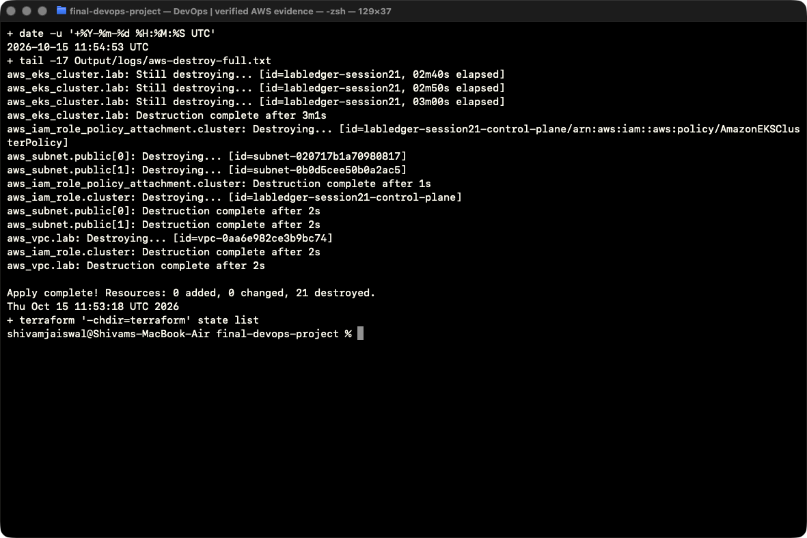
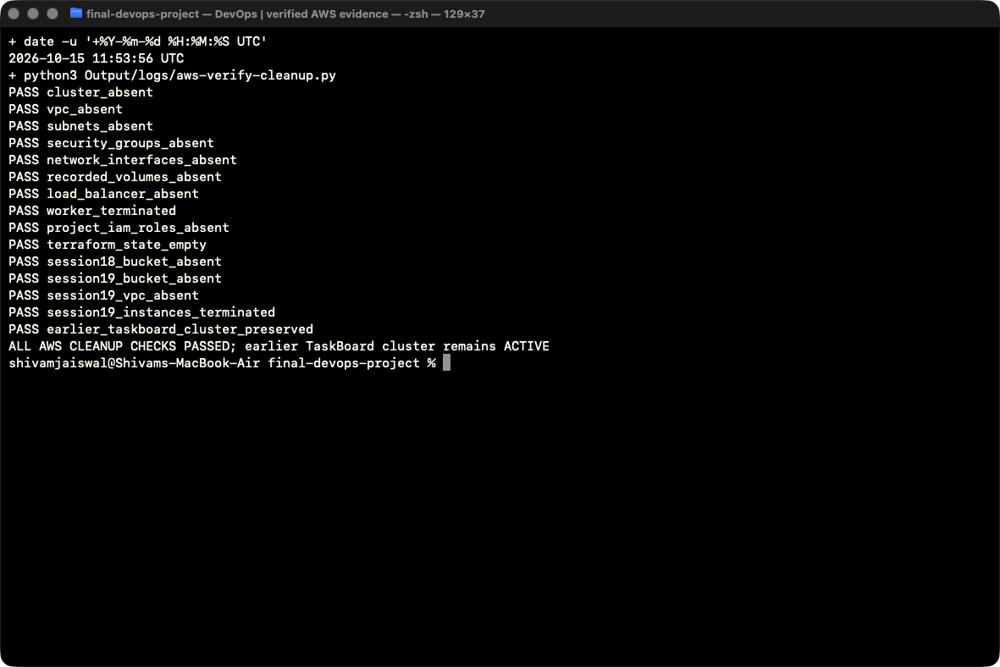

# Session 21 · Final DevOps Capstone

**Shivam Jaiswal · LabLedger · Campus equipment inventory and lending**

The completed student project is **[LabLedger](../final-devops-project/README.md)**. It implements an original inventory/lending application with React, FastAPI and PostgreSQL, then carries it through automated tests, Docker, CI/security gates, GHCR, Helm/Kubernetes, AWS EKS, monitoring, GitOps and troubleshooting.

The TaskBoard files in this folder are the supplied teaching reference. The [original lesson README](REFERENCE.md) and [grading rubric](GRADING.md) are preserved. LabLedger source, deployment instructions and all evidence live in `final-devops-project/`.

## Submission map

| Module | Delivered work | Evidence |
|---|---|---|
| M1 · Application | Asset CRUD, borrowing/returns, inventory consistency, original responsive UI, PostgreSQL migrations | [Application and APIs](../final-devops-project/README.md#application-and-tests) |
| M2 · Testing | 20 isolated backend tests, 91.71% recorded coverage; 6 frontend tests; live PostgreSQL concurrency checks | [Tests](../final-devops-project/Output/41-api-test-cases.png) · [Cloud business checks](../final-devops-project/Output/50-aws-business-verification.png) |
| M3 · Git/GitHub | Dedicated branch, meaningful history, ignored secrets/state, locked dependencies | [Commit history](../final-devops-project/Output/38-commit-history.png) |
| M4 · Docker | Multistage frontend, nonroot application images, three-service Compose and migration job | [Docker setup](../final-devops-project/README.md#docker-quick-start) |
| M5 · CI/CD | Tests/scans, native AMD64/ARM64 images, GHCR SHA tags, Kind verification and GitOps promotion | [Successful feature pipeline](https://github.com/shivam24bcs10251-sys/devops-heros/actions/runs/37620612050) |
| M6 · DevSecOps | Bandit, dependency audits, Gitleaks and blocking HIGH/CRITICAL Trivy gates | [Security reports](../final-devops-project/Output/reports/README.md) |
| M7 · Terraform/AWS | 21 live resources, VPC/two public subnets, EKS/worker, Console proof, successful destroy and absence checks | [AWS execution](../final-devops-project/README.md#aws-execution--15-october-2026) |
| M8 · Kubernetes/Helm | Two frontend/backend replicas, ClusterIP Services, Secret/ConfigMap, migration Job, Ingress, encrypted gp3 PVC, HPA | [AWS workloads](../final-devops-project/Output/48-aws-helm-workloads.png) |
| M9 · Observability | Two backend targets UP, real metrics, populated six-panel Grafana dashboard, request logs | [Cloud monitoring](../final-devops-project/Output/53-aws-grafana-dashboard.png) |
| M10 · Documentation | Architecture, reproducible setup, operations, four fault investigations and real screenshot gallery | [Complete project README](../final-devops-project/README.md) |

## Execution timeline and AWS isolation

- **7 October 2026:** original application, tests, Docker, two CI releases, local Kubernetes, monitoring, GitOps and troubleshooting evidence (`01`–`41`).
- **15 October 2026:** missing live AWS work completed in **New Frontiers / account `499567237930`**, **Sydney `ap-southeast-2`**, profile **`scaler-sst`** (`42`–`56`). The VPC, EKS cluster, ingress controller, database and kubeconfig were separate from existing resources.
- **After recording:** temporary LabLedger cloud resources were removed in dependency order. Its demonstration URL is historical. Existing local containers, the earlier AWS TaskBoard deployment and resources belonging to other accounts were preserved.

The historical IAM denial in image `08` is retained as a troubleshooting record; it is no longer the execution status. Provider account guards and explicit profile/kubeconfig selection protect against using another account.

## Key AWS evidence

### Live plan and AWS resources

### Runtime and monitoring

### Verified cleanup

[All 56 screenshots and their transcripts](../final-devops-project/README.md#screenshot-evidence) · [Resource snapshot](../final-devops-project/Output/reports/aws-live-resources.json) · [Cleanup report](../final-devops-project/Output/reports/aws-cleanup-verification.json).

## Reproduce or present

Use the [full project README](../final-devops-project/README.md) for local setup and the [Terraform guide](../final-devops-project/terraform/README.md) for the cloud deployment/teardown. `scripts/deploy-aws.sh` verifies the intended account and uses its own kubeconfig; it never starts or reuses the Mac's existing Docker containers.

A presentation can follow the recorded sequence: explain inventory/borrowing, run isolated tests, show the CI and SHA-tagged GHCR release, explain the AWS plan/Console, show Helm/Ingress/HPA and monitoring, demonstrate the documented failure/recovery cases, then show successful cloud cleanup. CI/scan results are dated evidence snapshots; source changes require another pipeline run before promoting new images.
